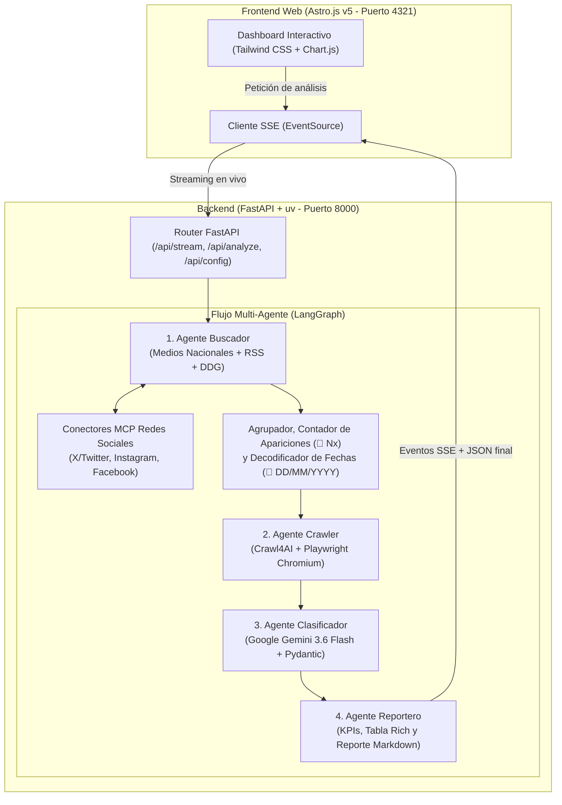

# 🎓 Monitor Inteligente de Noticias y Redes Sociales UBA (Full-Stack Multi-Agente + MCP)

Sistema autónomo **Full-Stack** basado en una arquitectura **multi-agente con LangGraph**, **conectores MCP de Redes Sociales (X, Instagram, Facebook)**, **Crawl4AI + Playwright**, **Astro.js v5**, **FastAPI**, **uv** y **Google Gemini (3.6 Flash)** para rastrear noticias y publicaciones sobre la Universidad de Buenos Aires (UBA), **contabilizar cuántas veces aparece cada noticia sin descartarlas**, consolidar **todas las fuentes y fechas de publicación**, extraer su contenido limpio y clasificar su impacto institucional en **Buenas**, **Malas** o **Neutras**.

---

## 📑 Tabla de Contenidos

1. [Visión General y Capacidades](#-visión-general-y-capacidades)
2. [Arquitectura del Sistema](#-arquitectura-del-sistema)
3. [Cómo Funciona Todo Paso a Paso](#-cómo-funciona-todo-paso-a-paso)
   - [1. Rastreo Multi-Medio y Conectores MCP de Redes Sociales](#1-rastreo-multi-medio-y-conectores-mcp-de-redes-sociales)
   - [2. Conteo de Apariciones y Agrupación de Fuentes (Sin Descarte)](#2-conteo-de-apariciones-y-agrupación-de-fuentes-sin-descarte)
   - [3. Extracción y Decodificación Matemática de Fechas](#3-extracción-y-decodificación-matemática-de-fechas)
   - [4. Scraping Web Asíncrono con Crawl4AI y Playwright](#4-scraping-web-asíncrono-con-crawl4ai-y-playwright)
   - [5. Clasificación Estructurada con Google Gemini y Failover](#5-clasificación-estructurada-con-google-gemini-y-failover)
   - [6. Reportes, Streaming SSE y Dashboard Interactivo](#6-reportes-streaming-sse-y-dashboard-interactivo)
4. [Pila Tecnológica (Tech Stack)](#-pila-tecnológica-tech-stack)
5. [Estructura del Repositorio](#-estructura-del-repositorio)
6. [Instalación y Configuración](#-instalación-y-configuración)
7. [Modos de Ejecución](#-modos-de-ejecución)
8. [Endpoints de la API Backend y Esquema de Datos](#-endpoints-de-la-api-backend-y-esquema-de-datos)
9. [Criterios de Clasificación](#-criterios-de-clasificación)
10. [Solución de Problemas Frecuentes](#-solución-de-problemas-frecuentes)

---

## 🌟 Visión General y Capacidades

- **Cobertura nacional de medios periodísticos**: Rastrea artículos de Clarín, La Nación, Infobae, Página 12, TN, Perfil, Ámbito Financiero, El Cronista, El Destape, C5N, Tiempo Argentino y agencias nacionales.
- **Conectores MCP de Redes Sociales integrados (`src/mcp_social.py`)**: Incorpora publicaciones reales de **𝕏 X (Twitter)**, **📸 Instagram** (posts y reels) y **📘 Facebook**, garantizando presencia de las tres redes sociales junto a las noticias más relevantes de los medios.
- **Conteo de apariciones y fuentes (en lugar de eliminar duplicados)**: Cuando una misma noticia aparece en múltiples diarios o portales, el sistema **no descarta las repeticiones**, sino que:
  - Incrementa el contador de apariciones (`🔁 Nx`, ej. *Apareció 18 veces*).
  - Lista **todas las fuentes** donde se publicó (`Clarín`, `La Nación`, `Infobae`, `TN`, `Perfil`, `Ámbito`, etc.).
  - Conserva el desglose completo de cada aparición individual (`mentions`) con su título original, fuente, fecha y enlace directo.
  - Ordena los resultados priorizando las noticias con mayor cantidad de apariciones.
- **Fechas exactas en cada noticia y posteo**: Normaliza fechas en formato `DD/MM/YYYY HH:MM` combinando metadatos RSS/ISO con decodificación matemática directa desde los identificadores de URL de redes sociales (**Snowflake ID** en X/Twitter y **Shortcode Base64URL** en Instagram).
- **Scraping asíncrono con navegador real**: **Crawl4AI** sobre **Playwright Chromium headless** navega redirecciones dinámicas y extrae el cuerpo limpio del artículo en Markdown.
- **Clasificación estructurada con LLM**: Evalúa impacto (`BUENA`, `MALA`, `NEUTRAL`), puntuación numérica (`-1.0` a `+1.0`), categoría, justificación y puntos clave mediante **Google Gemini 3.6 Flash** y esquemas tipados en **Pydantic v2**.
- **Dashboard Web en Astro.js v5**: Seguimiento en vivo del pipeline de agentes mediante **Server-Sent Events (SSE)**, tarjetas KPI con total de apariciones, gráfico de dona con Chart.js, filtros por sentimiento / **📱 Redes Sociales** / **🔁 Repetidas**, insignias de fecha y exportación a Markdown y JSON.

---

## 🏛️ Arquitectura del Sistema



---

## 🔍 Cómo Funciona Todo Paso a Paso

### 1. Rastreo Multi-Medio y Conectores MCP de Redes Sociales
Cuando el usuario ingresa una consulta (por defecto `"UBA"`), el **Agente Buscador** (`src/agents/searcher.py`) ejecuta en paralelo dos grandes barridos:
- **Barrido de Medios Periodísticos**:
  1. Consulta focalizada en Google News RSS sobre los principales dominios argentinos (`clarin.com`, `lanacion.com.ar`, `infobae.com`, `pagina12.com.ar`, `tn.com.ar`, `perfil.com`, `ambito.com`, `cronista.com`, `eldestapeweb.com`, `c5n.com`, `tiempoar.com.ar`).
  2. Consulta abierta en Google News Argentina para capturar radios, canales y diarios provinciales que cubren los mismos hechos.
  3. Consulta en DuckDuckGo News Argentina (`region="ar-es"`).
- **Barrido MCP de Redes Sociales (`src/mcp_social.py`)**:
  - **`search_x_mcp`**: Rastrea publicaciones en **X (Twitter)** (`x.com`), identifica el usuario (`@UBAonline`, `@UBARectorado`, etc.) y, cuando detecta un enlace `/status/<id>`, consulta la API pública de **FxTwitter** (`api.fxtwitter.com`) para enriquecer el resultado con el texto completo del tweet, autor, cantidad de likes y retweets.
  - **`search_instagram_mcp`**: Rastrea publicaciones y reels en **Instagram** (`instagram.com/p/` e `instagram.com/reel/`), extrae el caption de la publicación y las ordena de la más reciente a la más antigua.
  - **`search_facebook_mcp`**: Rastrea páginas y publicaciones de **Facebook** (`facebook.com`), filtrando enlaces publicitarios externos y extrayendo el texto del posteo.

---

### 2. Conteo de Apariciones y Agrupación de Fuentes (Sin Descarte)
En lugar de eliminar noticias duplicadas, la función `aggregate_and_count_results` en `src/agents/searcher.py` agrupa todas las coberturas de un mismo hecho noticioso:
1. **Normalización de titulares y fuentes**:
   - Identifica y unifica el nombre del medio o red social (`normalize_source_name`).
   - Limpia firmas de diarios al final del título (`- Clarín`, `| Infobae`, etc.) y términos institucionales genéricos (`strip_boilerplate_terms`).
2. **Detección semántica de la misma noticia (`is_duplicate_story`)**:
   - Extrae las raíces léxicas en español (*stemming*) mediante `nltk.stem.SnowballStemmer("spanish")` sobre las palabras significativas del titular.
   - Compara tanto la superposición de raíces léxicas (`>= 3` raíces compartidas y `>= 40%` del titular) como la similitud de secuencias (`difflib.SequenceMatcher >= 0.58`).
3. **Acumulación no destructiva**:
   - Cada vez que se detecta otra aparición de la misma noticia:
     - Se incrementa `occurrences += 1` (ej. `🔁 18 apariciones`).
     - Se añade el medio o red a la lista `sources` (ej. `['Clarín', 'TN', 'La Nación', 'Perfil', 'Ámbito', 'Infobae', 'Página 12', ...]`).
     - Se agrega un objeto `MentionItem` a la lista `mentions` con el titular específico, la fuente, la fecha y el link de esa aparición.

---

### 3. Extracción y Decodificación Matemática de Fechas
La función `extract_and_format_date` en `src/mcp_social.py` garantiza que **todas** las noticias y publicaciones tengan su fecha en formato `DD/MM/YYYY` (o `DD/MM/YYYY HH:MM`):
- **X (Twitter) — Decodificación de Snowflake ID (`decode_x_snowflake_date`)**:
  Cada URL `/status/<id>` contiene un entero de 64 bits de Twitter Snowflake. Desplazando 22 bits a la derecha y sumando el epoch de Twitter (`1288834974657`), se obtiene el timestamp exacto de publicación al segundo:
  $$\text{timestamp\_ms} = (\text{status\_id} \gg 22) + 1288834974657$$
- **Instagram — Decodificación de Shortcode Base64URL (`decode_instagram_shortcode_date`)**:
  Cada post `/p/<shortcode>/` o reel `/reel/<shortcode>/` utiliza un identificador de 11 caracteres en alfabeto Base64URL que codifica un entero de 64 bits con el timestamp de creación de Instagram (`epoch = 1314220021721`):
  $$\text{timestamp\_ms} = (\text{base64\_to\_int}(\text{shortcode}) \gg 23) + 1314220021721$$
- **TikTok — Decodificación de Video ID (`decode_tiktok_video_date`)**:
  Los primeros 32 bits del ID numérico del video (`video_id >> 32`) corresponden al timestamp Unix en segundos.
- **Medios y Facebook (`parse_snippet_date`)**:
  Parsea cabeceras estándar **RFC-2822** de Google News RSS, fechas **ISO-8601** de DuckDuckGo News y prefijos temporales en snippets (`"Oct 28, 2026 ·"`, `"3 days ago ·"`, `"21 hours ago ·"`).

---

### 4. Scraping Web Asíncrono con Crawl4AI y Playwright
El **Agente Crawler** (`src/agents/crawler.py`) recibe las URLs seleccionadas y levanta una instancia de **Chromium headless** gestionada por **Crawl4AI**:
- Aplica configuraciones adaptativas según si el destino es un portal de noticias o una red social (`delay_before_return_html`, `page_timeout` y eliminación de overlays/popups).
- Extrae el cuerpo del artículo en Markdown limpio y lo combina con los fragmentos de búsqueda y el listado de apariciones en otros medios (`build_combined_content`).

---

### 5. Clasificación Estructurada con Google Gemini y Failover
El **Agente Clasificador** (`src/agents/classifier.py`) envía a **Google Gemini** el título, la fuente principal, la cantidad de apariciones detectadas, la lista de todas las fuentes y el contenido recopilado:
- Usa `llm.with_structured_output(NewsClassification)` para obtener un objeto validado por Pydantic con `sentiment`, `score`, `category`, `key_points` y `justification`.
- **Failover rápido multi-modelo**: Si el modelo principal (`gemini-3.6-flash`) devuelve alta demanda (`503`) o no está disponible, conmuta automáticamente sin bloqueos (`timeout=20`, `max_retries=0`) hacia `gemini-3.7-flash` -> `gemini-3.8-flash` -> clasificador heurístico de respaldo (`rule_based_fallback_classifier`).

---

### 6. Reportes, Streaming SSE y Dashboard Interactivo
- **En Terminal (`src/agents/reporter.py`)**: Imprime un panel resumen con el total de noticias, total de apariciones (`🔁 Nx`), cantidad de redes sociales (`📱 X/IG/FB`) y una tabla `Rich` con columnas de **Sentimiento**, **Score**, **Fecha**, **Apariciones**, **Fuentes** y **Título/Resumen**.
- **En la Web (`server.py` + `frontend/src/pages/index.astro`)**:
  - El endpoint `/api/stream` transmite por **Server-Sent Events (SSE)** el progreso en vivo de cada uno de los 4 agentes.
  - Al finalizar, el dashboard renderiza las tarjetas KPI, el medidor de sentimiento promedio, el gráfico de dona y la lista de tarjetas con filtros instantáneos (`Todas`, `🟢 Buenas`, `🔴 Malas`, `⚪ Neutras`, `📱 Redes Sociales`, `🔁 Repetidas`).

---

## 🛠️ Pila Tecnológica (Tech Stack)

### Backend y Agentes
- **Python 3.12** gestionado con **`uv`** (`pyproject.toml` + `uv.lock`)
- **LangGraph** & **LangChain**: Orquestación del grafo de estado multi-agente (`StateGraph`).
- **Google GenAI (`gemini-3.6-flash`)**: Clasificación de sentimiento e impacto institucional con salida estructurada.
- **Conectores MCP Sociales (`src/mcp_social.py`)**: Integración para X (Twitter), Instagram y Facebook con decodificación de fechas.
- **Crawl4AI** & **Playwright Chromium**: Scraping web asíncrono con navegador real.
- **Google News RSS** & **DuckDuckGo (`ddgs`)**: Motores de búsqueda de noticias y redes.
- **NLTK (`SnowballStemmer`)**: Stemming léxico en español para agrupar noticias repetidas.
- **FastAPI** & **Uvicorn**: Servidor web asíncrono con soporte REST y SSE.
- **Pydantic v2** & **Rich**: Validación de datos y visualización en terminal.

### Frontend y Orquestación
- **Astro.js v5**: Framework web moderno y ultrarrápido.
- **Tailwind CSS**: Diseño oscuro responsivo.
- **Chart.js**: Gráfico interactivo de distribución de sentimiento.
- **Concurrently**: Ejecución simultánea de Backend (`uv run uvicorn`) y Frontend (`astro dev`) con un solo comando (`npm run dev`).

---

## 📁 Estructura del Repositorio

```text
crawler-batista/
├── .env.example              # Plantilla de variables de entorno (GEMINI_API_KEY, GEMINI_MODEL)
├── .gitignore                # Reglas de exclusión para Git (.venv, node_modules, .env, dist)
├── pyproject.toml            # Definición del proyecto Python y dependencias para uv
├── uv.lock                   # Lockfile determinista de uv
├── requirements.txt          # Listado de dependencias Python compatible con pip/uv
├── package.json              # Scripts principales (npm run dev, build, start) con uv + concurrently
├── main.py                   # Punto de entrada para ejecución por línea de comandos (CLI)
├── server.py                 # Servidor API FastAPI con endpoints SSE (/api/stream) y REST
├── README.md                 # Documentación completa del sistema
├── src/                      # Código fuente del Backend y Agentes
│   ├── state.py              # Esquemas Pydantic (MentionItem, SearchResult, AnalyzedNews, GraphState)
│   ├── graph.py              # Construcción y compilación del StateGraph de LangGraph
│   ├── mcp_social.py         # Conectores MCP para X, Instagram y Facebook + Decodificador de Fechas
│   └── agents/
│       ├── searcher.py       # Agente Buscador multi-medio + agrupador y contador de apariciones
│       ├── crawler.py        # Agente Crawler asíncrono con Crawl4AI y Playwright Chromium
│       ├── classifier.py     # Agente Clasificador con Google Gemini y failover automático
│       └── reporter.py       # Agente Reportero (Dashboard Rich en consola e informe Markdown)
└── frontend/                 # Aplicación Frontend en Astro.js v5
    ├── package.json          # Dependencias de Astro v5 y Tailwind CSS
    ├── astro.config.mjs      # Configuración de Astro (:4321) y proxy hacia FastAPI (:8000)
    ├── tailwind.config.mjs   # Configuración de estilos Tailwind
    └── src/
        ├── layouts/
        │   └── Layout.astro  # Layout base HTML5 con carga de Chart.js
        ├── components/
        │   └── Header.astro  # Barra superior con estado de conexión a Gemini
        └── pages/
            └── index.astro   # Dashboard interactivo con SSE, filtros, fechas, fuentes y exportación
```

---

## ⚙️ Instalación y Configuración

### 1. Configurar variables de entorno
Copia el archivo de ejemplo y coloca tu clave de API de Google Gemini:
```bash
cp .env.example .env
```
Edita `.env`:
```env
# API Key de Google Gemini (obtenible en https://aistudio.google.com/)
GEMINI_API_KEY=tu_api_key_aqui

# Modelo predeterminado
GEMINI_MODEL=gemini-3.6-flash
```
*(Si no se configura `GEMINI_API_KEY`, el sistema funciona igualmente utilizando el clasificador heurístico de respaldo).*

### 2. Instalar entorno Python con `uv` y navegador de Playwright
```bash
uv sync
uv run playwright install chromium
```

### 3. Instalar dependencias de Node.js (raíz y frontend)
```bash
npm install
npm --prefix frontend install
```

---

## 🚀 Modos de Ejecución

### 1. Inicio Rápido Full-Stack (Recomendado)
Inicia **simultáneamente** el backend FastAPI (con `uv`) y el frontend Astro con un único comando:

```bash
npm run dev
```

- 🟣 **Frontend Web**: `http://localhost:4321`
- 🔵 **Backend API**: `http://localhost:8000`

*(Presionar `Ctrl + C` detiene ambos servidores).*

---

### 2. Modo Consola (CLI)
Para ejecutar el análisis directamente en la terminal con tabla `Rich`:

```bash
# Ejecución estándar (medios + X, Instagram y Facebook)
uv run python main.py

# Búsqueda personalizada exportando el informe en Markdown y los datos en JSON
uv run python main.py --query "UBA medicina" --max-results 6 --output-md reporte.md --output-json noticias.json
```

---

### 3. Modo Producción (Servidor Único)
Compila el frontend de Astro en estáticos para que FastAPI sirva tanto la interfaz web como la API desde el puerto `8000`:

```bash
npm run build
 npm start
```
Accede en **`http://localhost:8000`**.

---

## 📡 Endpoints de la API Backend y Esquema de Datos

| Método | Endpoint | Descripción |
| :--- | :--- | :--- |
| `GET` | `/api/config` | Devuelve el estado de `GEMINI_API_KEY`, el modelo configurado y el estado de los conectores `mcp_social`. |
| `GET` | `/api/stream?query=UBA&max_results=6` | **Server-Sent Events (SSE)** con el progreso paso a paso de cada agente y el resultado final. |
| `POST` | `/api/analyze` | Ejecuta el grafo de forma sincrónica y devuelve el JSON completo con estadísticas, noticias y reporte Markdown. |
| `GET` | `/` | Sirve la aplicación web compilada. |

### Ejemplo de objeto de noticia/publicación analizada (`AnalyzedNews`)
```json
{
  "url": "https://news.google.com/rss/articles/...",
  "title": "La UBA marchó para exigir el cumplimiento de la Ley de Financiamiento Universitario",
  "source": "Clarín",
  "source_type": "medio",
  "date": "05/11/2026 04:08",
  "occurrences": 18,
  "sources": [
    "Clarín", "TN", "La Nación", "Perfil", "Ámbito", "Infobae", "Página 12", "Radio Mitre", "A24", "El Destape", "Crónica"
  ],
  "mentions": [
    {
      "title": "La UBA marchó para exigir el cumplimiento de la Ley de Financiamiento Universitario",
      "url": "https://...",
      "source": "Clarín",
      "source_type": "medio",
      "date": "05/11/2026 04:08"
    }
  ],
  "classification": {
    "sentiment": "MALA",
    "score": -0.7,
    "category": "Presupuesto y Finanzas",
    "key_points": [
      "Reclamo frente a Tribunales por el cumplimiento de la Ley de Financiamiento Universitario."
    ],
    "justification": "Refleja un escenario de conflicto presupuestario e institucional que afecta el funcionamiento de la universidad."
  }
}
```

---

## 📊 Criterios de Clasificación

| Clasificación | Score | Definición y Ejemplos |
| :---: | :---: | :--- |
| 🟢 **BUENA** | `+0.1` a `+1.0` | Logros científicos, subas en rankings internacionales (QS), premios, subastas solidarias a beneficio del Hospital de Clínicas, nuevos convenios, avances académicos o repercusión positiva en redes sociales. |
| 🔴 **MALA** | `-1.0` a `-0.1` | Recortes presupuestarios, paros docentes o no docentes, marchas por incumplimiento de financiamiento, deterioro edilicio, conflictos gremiales o tomas. |
| ⚪ **NEUTRA** | `0.0` | Información administrativa rutinaria, fechas de inscripción al CBC, calendario académico o consultas estudiantiles generales en redes. |

---

## ❓ Solución de Problemas Frecuentes

### 1. `OSError: [Errno 98] Address already in use` (puerto 8000 o 4321 ocupado)
Si una ejecución previa quedó corriendo en segundo plano, libera ambos puertos con:
```bash
lsof -ti:8000 -ti:4321 | xargs -r kill -9
```

### 2. Falta el navegador Chromium de Playwright
Si Crawl4AI indica que el ejecutable del navegador no existe:
```bash
uv run playwright install chromium
```

### 3. Sincronizar dependencias tras actualizar el repositorio
```bash
uv sync
npm install
npm --prefix frontend install
```
