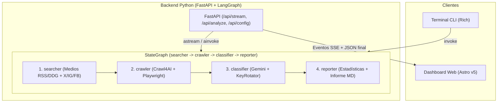

# Monitor de Noticias y Redes Sociales UBA

Aplicación full-stack para relevar, agrupar, extraer y clasificar noticias y publicaciones públicas sobre la Universidad de Buenos Aires (UBA). Combina un grafo multi-agente en **LangGraph** (`FastAPI`, `Crawl4AI`/`Playwright` y `Google Gemini`) con una interfaz estática en **Astro.js v5** y una CLI basada en **Rich**.

Para el detalle de decisiones de diseño, alternativas evaluadas y límites operativos, ver [DESIGN.md](DESIGN.md).

## Tabla de Contenidos

1. [Capacidades Principales](#capacidades-principales)
2. [Arquitectura del Sistema](#arquitectura-del-sistema)
3. [Funcionamiento Paso a Paso](#funcionamiento-paso-a-paso)
4. [Pila Tecnológica y Estructura del Repositorio](#pila-tecnológica-y-estructura-del-repositorio)
5. [Requisitos Previos e Instalación](#requisitos-previos-e-instalación)
6. [Modos de Ejecución y Verificación](#modos-de-ejecución-y-verificación)
7. [API Backend y Esquema de Datos](#api-backend-y-esquema-de-datos)
8. [Criterios de Clasificación](#criterios-de-clasificación)

---

## Capacidades Principales

- **Búsqueda paralela en medios argentinos y redes sociales**: consulta Google News RSS, DuckDuckGo News y búsquedas dirigidas en `X`, `Instagram` y `Facebook` (con enriquecimiento público de tweets vía FxTwitter cuando aplica). Las consultas introducidas actúan siempre como filtro temático dentro del ámbito UBA y Argentina.
- **Agrupación por similitud y conteo de apariciones**: consolida cobertura repetida de un mismo hecho dentro de cada tipo de fuente, manteniendo el conteo total (`occurrences`), la lista de medios o cuentas (`sources`) y el historial individual (`mentions`).
- **Normalización de fechas**: decodifica marcas temporales desde IDs Snowflake de X, shortcodes de Instagram, metadatos RSS/ISO-8601 y fragmentos relativos en hora Argentina (`America/Argentina/Buenos_Aires`). Si una fuente no provee fecha verificable, devuelve `Sin fecha` (`null`) sin inventar la fecha actual.
- **Extracción web concurrente y acotada**: utiliza Crawl4AI y Playwright (Chromium headless) validando destinos HTTP/HTTPS públicos, con respaldo automático en snippets de búsqueda cuando un portal bloquea el acceso.
- **Clasificación estructurada con rotación de claves**: integra Google Gemini 3.6 (`gemini-3.6-flash`) mediante esquema Pydantic (`BUENA`, `MALA`, `NEUTRAL`), rotación round-robin de API keys, cooldowns y clasificador heurístico por palabras clave si todas las claves se agotan. No utiliza versiones distintas a 3.6.
- **Interfaz web y CLI**: transmite progreso por SSE desde el grafo LangGraph al dashboard Astro.js (filtros en cliente, gráfico con `Chart.js` empaquetado localmente y exportación Markdown/JSON) o imprime tablas resumen desde terminal.

---

## Arquitectura del Sistema



CLI (`main.py`), `POST /api/analyze` y `GET /api/stream` comparten el mismo grafo `LangGraph` definido en [src/graph.py](src/graph.py).

---

## Funcionamiento Paso a Paso

### 1. Búsqueda y agrupación de apariciones (`src/agents/searcher.py`, `src/mcp_social.py`)

- Ejecuta en paralelo consultas a Google News RSS (medios configurados en `ARGENTINE_DOMAINS` y búsqueda general Argentina), DuckDuckGo News y los adaptadores sociales en proceso para `X`, `Instagram` y `Facebook`.
- Normaliza los nombres de fuente (por ejemplo, variantes de `Ámbito`, `Clarín`, `La Nación` o perfiles sociales) y agrupa titulares equivalentes mediante stemming léxico en español y similitud de secuencias.
- Selecciona hasta `max_results` temas combinando resultados de medios ordenados por `occurrences` y representación de redes sociales cuando existen resultados disponibles.

### 2. Extracción de contenido (`src/agents/crawler.py`)

- Toma la URL representativa de cada tema agrupado, verifica que corresponda a un destino HTTP(S) público (bloqueando direcciones locales o redes privadas) y ejecuta Chromium headless con concurrencia acotada para convertir el cuerpo principal a Markdown.
- Si un sitio bloquea el scraper o devuelve error, conserva el resumen de búsqueda y los titulares de las menciones agrupadas para que el clasificador evalúe el tema sin fallar el flujo.

### 3. Clasificación y rotación de API Keys (`src/agents/classifier.py`, `src/key_manager.py`)

- Combina el snippet, hasta diez menciones agrupadas y el Markdown extraído (acotado al contexto configurado) y solicita una salida estructurada `NewsClassification` a Google Gemini utilizando exclusivamente la versión 3.6 (`gemini-3.6-flash`).
- `GeminiKeyRotator` rota las claves configuradas de forma thread-safe, aplica cooldown temporal ante errores `429` y excluye claves inválidas (`401`/`403`). Si todas las claves disponibles están en cooldown, abre el circuito temporalmente hacia el respaldo heurístico por palabras clave en lugar de reintentar claves bloqueadas.
- No utiliza versiones alternativas distintas a 3.6. Ante cualquier error que impida clasificar con el pool de claves en Gemini 3.6, se conmuta limpiamente al clasificador heurístico de respaldo.

### 4. Reporte y entrega (`src/agents/reporter.py`, `server.py`, `frontend/`)

- Calcula estadísticas agregadas en un único helper compartido (`compute_stats`) y genera un informe en Markdown.
- En modo web, FastAPI emite por `GET /api/stream` los cambios de estado del grafo mediante SSE hacia el frontend estático compilado en Astro.js.

---

## Pila Tecnológica y Estructura del Repositorio

- **Backend**: Python 3.12+, `uv`, FastAPI, Uvicorn, LangGraph, Pydantic v2, `langchain-google-genai`.
- **Extracción y NLP**: `crawl4ai`, `playwright`, `ddgs`, `nltk` (`SnowballStemmer`).
- **Frontend**: Astro.js v5, Tailwind CSS, `chart.js` (empaquetado con Vite en el build estático) y Rich para salida CLI.

```text
crawler/
├── .env.example              # Plantilla de variables de entorno
├── DESIGN.md                 # Decisiones de arquitectura, alternativas y límites
├── README.md                 # Documentación principal
├── main.py                   # Punto de entrada CLI
├── server.py                 # Servidor FastAPI (REST, SSE y frontend estático)
├── package.json              # Scripts de desarrollo y build (dev, build, start)
├── pyproject.toml            # Dependencias Python (gestión canónica con uv)
├── uv.lock                   # Lockfile de dependencias Python
├── src/
│   ├── graph.py              # Grafo LangGraph síncrono y asíncrono
│   ├── key_manager.py        # Rotación y cooldown de claves Gemini
│   ├── mcp_social.py         # Búsqueda social (X, Instagram, Facebook) y normalización de fechas
│   ├── state.py              # TypedDict GraphState y modelos Pydantic de respuesta
│   └── agents/
│       ├── searcher.py       # Búsqueda paralela y agrupación léxica
│       ├── crawler.py        # Scraping concurrente acotado y validación SSRF
│       ├── classifier.py     # Clasificación Gemini, circuit breaker y respaldo heurístico
│       └── reporter.py       # Estadísticas compartidas, informe Markdown y tablas Rich
└── frontend/
    ├── astro.config.mjs      # Configuración de Astro y proxy /api -> :8000 en dev
    ├── package.json          # Dependencias Astro, Tailwind y Chart.js
    └── src/
        ├── layouts/Layout.astro
        ├── components/Header.astro
        └── pages/index.astro # Dashboard interactivo (SSE, Chart.js, filtros, exportación)
```

---

## Requisitos Previos e Instalación

- **Python** `>= 3.12`
- **uv** (gestor de entornos y dependencias Python)
- **Node.js** `>= 18` y **npm**

1. **Instalar dependencias Python y Chromium (Playwright)**:

```bash
uv sync
uv run playwright install chromium
```

En distribuciones Linux sin dependencias gráficas previas del navegador, ejecuta también:

```bash
uv run playwright install-deps chromium
```

2. **Configurar variables de entorno**:

```bash
cp .env.example .env
```

Edita `.env` con al menos una clave válida de [Google AI Studio](https://aistudio.google.com/):

```dotenv
# Clave única o varias separadas por coma para rotación automática
GEMINI_API_KEY=tu_api_key_1,tu_api_key_2
# Modelo fijo: exclusivamente versión 3.6 (gemini-3.6-flash)
GEMINI_MODEL=gemini-3.6-flash
```

El gestor acepta también `GEMINI_API_KEYS`, `GOOGLE_API_KEY` o variables numeradas (`GEMINI_API_KEY_1`, `GEMINI_API_KEY_2`, ...). Si no hay claves válidas configuradas, el sistema opera con el clasificador heurístico por palabras clave.

3. **Instalar dependencias del frontend**:

```bash
npm install
npm --prefix frontend install
```

---

## Modos de Ejecución y Verificación

### Modo Desarrollo (Backend + Frontend con recarga)

Ejecuta simultáneamente FastAPI (`:8000`) y el servidor de desarrollo Astro (`:4321`, con proxy `/api` configurado hacia `:8000` en `frontend/astro.config.mjs`):

```bash
npm run dev
```

Abre `http://localhost:4321` en el navegador.

### Modo CLI (Terminal)

```bash
uv run python main.py --query "presupuesto" --max-results 6 --output-md reporte.md --output-json resultados.json
```

Opciones disponibles en `main.py`:

- `--query`: filtro temático sobre la UBA (por defecto `"UBA"`).
- `--max-results`: cantidad máxima de temas agrupados a analizar (por defecto `5`).
- `--output-md`: ruta opcional para exportar el informe Markdown.
- `--output-json`: ruta opcional para exportar la lista JSON de noticias analizadas (`List[AnalyzedNews]`).

### Modo Servidor Único (Local)

Compila la interfaz estática en `frontend/dist/` y sirve frontend + API desde un único proceso FastAPI:

```bash
npm run build
npm start
```

Requiere haber ejecutado `npm run build` previamente para que `GET /` sirva la interfaz en `http://localhost:8000` (o `127.0.0.1:8000`). Por defecto `python server.py` enlaza `127.0.0.1:8000` sin `reload`. Para variables de red o CORS en entornos locales personalizados, consulta `HOST`, `PORT`, `UVICORN_RELOAD` y `CORS_ORIGINS` en [server.py](server.py).

### Verificación rápida tras instalar

```bash
uv run python main.py --help
curl -s http://localhost:8000/api/config
```

Con `npm run dev` o `npm start` activos, `/api/config` debe responder HTTP `200` con el estado de claves y plataformas habilitadas.

---

## API Backend y Esquema de Datos

La especificación OpenAPI completa (modelos `ConfigResponse`, `AnalyzeRequest`, `AnalyzeResponse` y `AnalyzedNews`) se genera automáticamente en `/docs` (`/openapi.json`) cuando el backend está en ejecución.

- **`GET /api/config`**: devuelve `{ gemini_configured, gemini_keys_count, gemini_key_status, model, default_query, social_status }`.
- **`POST /api/analyze`**: recibe `{ "query": "UBA", "max_results": 6 }` (`query` de 1 a 200 caracteres; `max_results` entre `1` y `15`), ejecuta el grafo de forma asíncrona no bloqueante y devuelve `{ query, total, stats, news, summary_report }`.
- **`GET /api/stream`**: parámetros de query `query` (`1..200` caracteres, defecto `"UBA"`) y `max_results` (`1..15`, defecto `6`). Transmite tramas SSE JSON `{"step", "message", "payload"}` para los eventos `start`, `searcher`, `searcher_done`, `crawler`, `crawler_done`, `classifier`, `classifier_progress`, `completed` y `error`.

Nota sobre rangos por interfaz: la CLI toma por defecto `max_results=5`, el endpoint `/api/analyze` y `/api/stream` aceptan `1..15` (defecto `6`), y el control deslizante del dashboard cubre `3..12` (defecto `6`). La CLI con `--output-json` exporta únicamente el arreglo `AnalyzedNews[]`, mientras que la API y el botón **Exportar JSON** del panel web exportan el objeto completo `{ query, total, stats, news, summary_report }`.

Ejemplo de elemento `AnalyzedNews` dentro de `news`:

```json
{
  "url": "https://news.google.com/rss/articles/...",
  "title": "La UBA fue distinguida en el ranking internacional QS",
  "source": "Infobae",
  "source_type": "medio",
  "date": "06/11/2026 14:30",
  "occurrences": 2,
  "sources": ["Infobae", "Clarín"],
  "mentions": [
    {
      "title": "La UBA fue distinguida en el ranking internacional QS",
      "url": "https://www.infobae.com/educacion/...",
      "source": "Infobae",
      "source_type": "medio",
      "date": "06/11/2026 14:30"
    },
    {
      "title": "Reconocimiento internacional a facultades de la UBA",
      "url": "https://www.clarin.com/sociedad/...",
      "source": "Clarín",
      "source_type": "medio",
      "date": "06/11/2026 15:10"
    }
  ],
  "classification": {
    "sentiment": "BUENA",
    "score": 0.85,
    "category": "Logros Académicos y Científicos",
    "key_points": [
      "Mejora en indicadores de investigación y empleabilidad"
    ],
    "justification": "La cobertura destaca posicionamiento académico e impacto positivo para la institución."
  }
}
```

Valores válidos de `source_type`: `"medio"` o `"red_social"`.

---

## Criterios de Clasificación

La etiqueta estructurada `classification.sentiment` utiliza únicamente los literales `"BUENA"`, `"MALA"` o `"NEUTRAL"`:

- **BUENA** (`score` en `[+0.1, +1.0]`): logros científicos, becas, convenios, mejoras presupuestarias o reconocimientos internacionales.
- **NEUTRAL** (`score` en `(-0.1, +0.1)`): comunicados informativos, fechas de inscripción al Ciclo Básico Común (CBC) o cronogramas sin carga valorativa marcada.
- **MALA** (`score` en `[-1.0, -0.1]`): conflictos gremiales o paros con pérdida de clases, recortes presupuestarios, crisis edilicias o denuncias institucionales.
