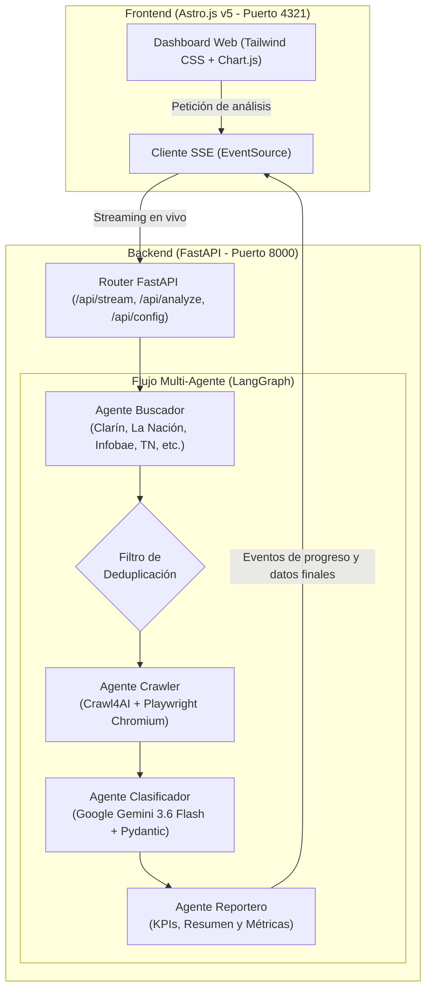

# 🎓 Monitor Inteligente de Noticias UBA (Full-Stack Multi-Agente)

Sistema autónomo **Full-Stack** basado en una arquitectura **multi-agente con LangGraph**, **Crawl4AI + Playwright**, **Astro.js v5**, **FastAPI** y **Google Gemini (3.6 Flash)** para rastrear noticias de la Universidad de Buenos Aires (UBA) en los principales medios argentinos, extraer su contenido limpio y clasificar su impacto institucional en **Buenas**, **Malas** o **Neutras**.

---

## 📑 Tabla de Contenidos

1. [Visión General y Capacidades](#-visión-general-y-capacidades)
2. [Arquitectura del Sistema](#-arquitectura-del-sistema)
3. [Pila Tecnológica (Tech Stack)](#-pila-tecnológica-tech-stack)
4. [Estructura del Repositorio](#-estructura-del-repositorio)
5. [Instalación y Configuración](#-instalación-y-configuración)
6. [Modos de Ejecución](#-modos-de-ejecución)
   - [Inicio Rápido Full-Stack (`npm run dev`)](#1-inicio-rápido-full-stack-recomendado)
   - [Ejecución por Línea de Comandos (CLI)](#2-modo-consola-cli)
   - [Ejecución en Proceso Único (Producción)](#3-modo-producción-proceso-único)
7. [Detalle de los Agentes (LangGraph)](#-detalle-de-los-agentes-langgraph)
8. [Endpoints de la API Backend](#-endpoints-de-la-api-backend)
9. [Criterios de Clasificación](#-criterios-de-clasificación)
10. [Solución de Problemas Frecuentes](#-solución-de-problemas-frecuentes)

---

## 🌟 Visión General y Capacidades

- **Cobertura nacional de medios**: Rastrea artículos de Clarín, La Nación, Infobae, Página 12, TN, Perfil, Ámbito Financiero, El Cronista, El Destape y C5N.
- **Deduplicación semántica**: Descarta noticias duplicadas comparando la similitud de los titulares mediante *stemming* (raíces léxicas en español con NLTK) y similitud de secuencias.
- **Scraping asíncrono con navegador real**: Crawl4AI corre sobre Playwright Chromium headless, permitiendo navegar redirecciones dinámicas y extraer únicamente el cuerpo del artículo en Markdown limpio.
- **Clasificación estructurada con LLM**: Evalúa impacto, tono, puntuación numérica (-1.0 a +1.0), justificación y puntos clave mediante **Google Gemini 3.6 Flash** y schemas tipados en Pydantic.
- **Frontend interactivo en Astro.js**: Tablero moderno con seguimiento visual del pipeline de agentes paso a paso mediante **Server-Sent Events (SSE)**, gráficos de sentimiento con Chart.js, filtros y exportación a JSON/Markdown.

---

## 🏛️ Arquitectura del Sistema

El flujo completo se organiza en dos capas desacopladas que se comunican de forma reactiva:



---

## 🛠️ Pila Tecnológica (Tech Stack)

### Backend
- **Python 3.12**
- **LangGraph** & **LangChain**: Orquestación del grafo cíclico/secuencial de agentes.
- **Google GenAI (`gemini-3.6-flash`)**: Clasificación de sentimiento e impacto con structured output.
- **Crawl4AI**: Motor de crawling web optimizado para LLMs.
- **Playwright Chromium**: Automatización de navegador para extracción de contenido tras JavaScript y redirecciones.
- **DuckDuckGo Search (`ddgs`)** & **Google News RSS**: Motores de búsqueda de noticias sin límite de cuotas de pago.
- **FastAPI** & **Uvicorn**: Servidor asíncrono con soporte de Server-Sent Events (SSE).
- **Pydantic v2**: Validación y tipado estricto de esquemas.

### Frontend
- **Astro.js v5**: Framework web moderno, ultrarrápido y ligero.
- **Tailwind CSS**: Estilos utilitarios para interfaz oscura y responsiva.
- **Chart.js**: Renderizado del gráfico de dona de sentimiento.
- **Lucide Icons**: Iconografía SVG.

### Orquestación
- **Concurrently**: Ejecución simultánea del servidor Python y el frontend de Astro en un único comando.

---

## 📁 Estructura del Repositorio

```text
crawler/
├── .env.example              # Plantilla de variables de entorno
├── .gitignore                # Reglas de exclusión para Git (venv, node_modules, keys, caches)
├── package.json              # Scripts npm y dependencias de orquestación (concurrently)
├── package-lock.json         # Lockfile de Node
├── requirements.txt          # Dependencias de Python
├── main.py                   # Ejecutable CLI por terminal
├── server.py                 # Servidor API FastAPI con endpoints SSE y REST
├── README.md                 # Documentación técnica completa
├── src/                      # Código fuente del Backend
│   ├── state.py              # Modelos Pydantic y TypedDict para el estado de LangGraph
│   ├── graph.py              # Ensamblado del StateGraph
│   └── agents/
│       ├── searcher.py       # Buscador multi-fuente con motor de deduplicación
│       ├── crawler.py        # Crawler Playwright/Crawl4AI con compensación de redirecciones
│       ├── classifier.py     # Clasificador con failover multi-modelo Gemini
│       └── reporter.py       # Generador de reportes en Markdown y consola Rich
└── frontend/                 # Aplicación Frontend Astro.js
    ├── package.json          # Dependencias de Astro, Tailwind y Lucide
    ├── astro.config.mjs      # Configuración de Astro y proxy hacia FastAPI (:8000)
    ├── tailwind.config.mjs   # Configuración de Tailwind CSS
    └── src/
        ├── layouts/
        │   └── Layout.astro  # Layout base HTML5
        ├── components/
        │   └── Header.astro  # Barra de navegación con indicador de estado del LLM
        └── pages/
            └── index.astro   # Página principal interactiva con dashboard y SSE
```

---

## ⚙️ Instalación y Configuración

### 1. Clonar el repositorio
```bash
git clone <URL_DEL_REPOSITORIO>
cd crawler
```

### 2. Configurar variables de entorno
Copia el archivo de ejemplo y añade tu clave de API:
```bash
cp .env.example .env
```
Edita `.env`:
```env
# API Key de Google Gemini (obtenible en https://aistudio.google.com/)
GEMINI_API_KEY=tu_api_key_aqui

# Modelo predeterminado
GEMINI_MODEL=gemini-3.6-flash
```

### 3. Instalar dependencias de Python y navegador
Crea y activa el entorno virtual:
```bash
python3 -m venv .venv
source .venv/bin/activate
pip install -r requirements.txt
playwright install chromium
```

### 4. Instalar dependencias de Node.js
```bash
npm install
cd frontend && npm install && cd ..
```

---

## 🚀 Modos de Ejecución

### 1. Inicio Rápido Full-Stack (Recomendado)

Inicia **concurrentemente** el backend FastAPI y el frontend Astro con un solo comando:

```bash
npm run dev
```

- 🟣 **Frontend**: Accede a **`http://localhost:4321`**
- 🔵 **Backend**: Escuchando en **`http://localhost:8000`**

*(Presionar `Ctrl + C` finaliza ambos procesos de manera segura).*

---

### 2. Modo Consola (CLI)

Si deseas ejecutar el monitor directamente en la terminal sin navegador:

```bash
source .venv/bin/activate

# Análisis básico (5 noticias sobre UBA)
python main.py

# Búsqueda específica con exportación a Markdown y JSON
python main.py --query "UBA presupuesto medicina" --max-results 8 --output-md reporte.md --output-json noticias.json
```

---

### 3. Modo Producción (Proceso Único)

Puedes compilar el frontend en archivos estáticos para que el propio servidor FastAPI sirva tanto la API como la interfaz web en el puerto `8000`:

```bash
# 1. Compilar frontend de Astro
cd frontend && npm run build && cd ..

# 2. Iniciar servidor FastAPI
source .venv/bin/activate
python server.py
```
Accede directamente a **`http://localhost:8000`**.

---

## 🤖 Detalle de los Agentes (LangGraph)

### 1. Agente Buscador (`src/agents/searcher.py`)
- Realiza consultas focalizadas hacia los dominios de los principales diarios argentinos (`site:clarin.com`, `site:lanacion.com.ar`, `site:infobae.com`, `site:tn.com.ar`, `site:pagina12.com.ar`, etc.).
- Complementa con DuckDuckGo News Argentina (`region="ar-es"`).
- **Algoritmo de Deduplicación**:
  - Limpia URLs descartando parámetros de tracking (`utm_*`, `fbclid`, `oc`).
  - Normaliza títulos descartando sufijos de medios y caracteres diacríticos.
  - Aplica *stemming* con `nltk.stem.SnowballStemmer("spanish")` y calcula similitud de secuencias (`SequenceMatcher`). Si dos titulares refieren al mismo hecho o subasta noticiosa, solo se conserva una versión.

### 2. Agente Crawler (`src/agents/crawler.py`)
- Emplea `AsyncWebCrawler` de Crawl4AI con `BrowserConfig(browser_type="chromium", headless=True)`.
- Posee un retardo controlado (`delay_before_return_html=2.5s`) para permitir que las redirecciones de Google News y los scripts de los diarios resuelvan la URL canónica final.
- Extrae el texto principal en Markdown descartando anuncios, menús y pies de página.

### 3. Agente Clasificador (`src/agents/classifier.py`)
- Recibe el texto extraído y consulta a **Google Gemini 3.6 Flash**.
- Utiliza `with_structured_output(NewsClassification)` garantizando un formato estricto:
  - `sentiment`: `"BUENA"` | `"MALA"` | `"NEUTRAL"`
  - `score`: Número flotante entre `-1.0` y `+1.0`.
  - `category`: Categoría asignada (ej: *"Presupuesto"*, *"Ciencia y Tecnología"*, *"Gremial"*).
  - `justification`: Explicación sintética del impacto evaluado.
  - `key_points`: Lista de puntos sobresalientes.
- **Failover automático**: Si un modelo reporta saturación por alta demanda (error 503), conmuta de forma inmediata a los modelos alternativos (`gemini-3.7-flash`, `gemini-3.8-flash`) o al clasificador heurístico de respaldo.

### 4. Agente Reportero (`src/agents/reporter.py`)
- Totaliza cantidades y porcentajes de notas buenas vs. malas.
- Calcula el índice de impacto promedio.
- Renderiza el tablero visual con `rich` en consola y genera el informe Markdown.

---

## 📡 Endpoints de la API Backend

| Método | Endpoint | Descripción |
| :--- | :--- | :--- |
| `GET` | `/api/config` | Verifica si la API key de Gemini está activa y devuelve el modelo actual. |
| `GET` | `/api/stream?query=...&max_results=...` | Flujo **Server-Sent Events (SSE)** que emite eventos de avance de cada agente en tiempo real. |
| `POST` | `/api/analyze` | Endpoint REST sincrónico que ejecuta el grafo y devuelve el JSON completo. |
| `GET` | `/` | Sirve la interfaz web SPA compilada. |

---

## 📊 Criterios de Clasificación

| Clasificación | Score | Definición y Ejemplos |
| :---: | :---: | :--- |
| 🟢 **BUENA** | `+0.1` a `+1.0` | Avances científicos, reconocimientos internacionales, subas en rankings (ej: QS), convenios, inauguración de laboratorios, donaciones o hitos académicos. |
| 🔴 **MALA** | `-1.0` a `-0.1` | Conflictos gremiales, paros, recortes presupuestarios, deterioro edilicio, tomas de facultades o cancelaciones de programas. |
| ⚪ **NEUTRA** | `0.0` | Trámites administrativos rutinarios, calendarios de inscripción al CBC, información formal sin controversia. |

---

## ❓ Solución de Problemas Frecuentes

### 1. `Error: connect ECONNREFUSED 127.0.0.1:8000` al iniciar
- **Causa**: Astro levanta en ~20 ms, mientras que Python tarda ~1.5 segundos en importar librerías pesadas (`playwright`, `crawl4ai`).
- **Solución**: El frontend cuenta con auto-reintento incorporado; en un par de segundos el indicador superior pasa automáticamente a verde (`Google Gemini`).

### 2. `Address already in use` (puerto 8000 o 4321 ocupado)
Si un proceso anterior quedó en segundo plano, libéralo con:
```bash
lsof -ti:8000 -ti:4321 | xargs -r kill -9
```

### 3. Faltan dependencias de navegador de Playwright
Si Crawl4AI reporta que falta Chromium:
```bash
source .venv/bin/activate
playwright install chromium
```
